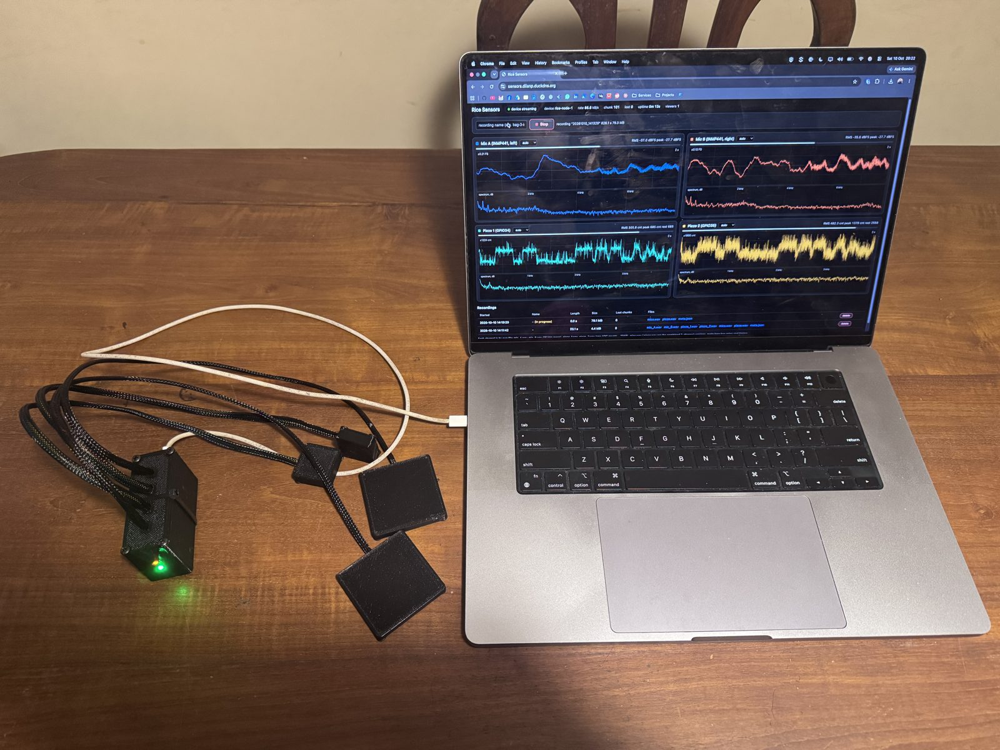
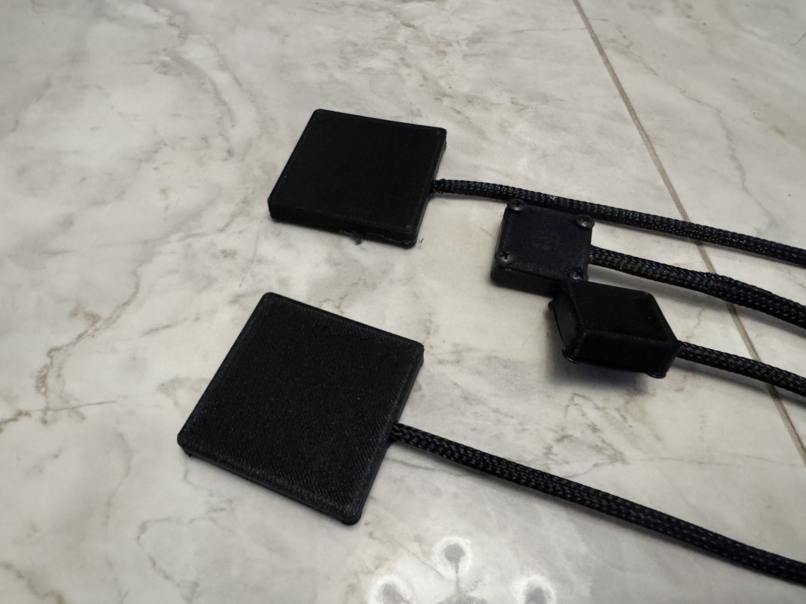
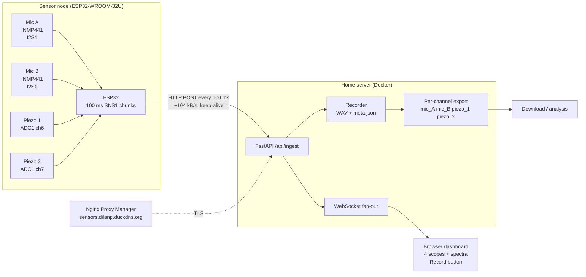
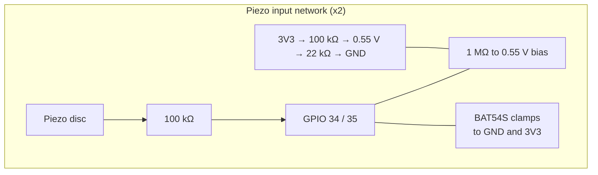
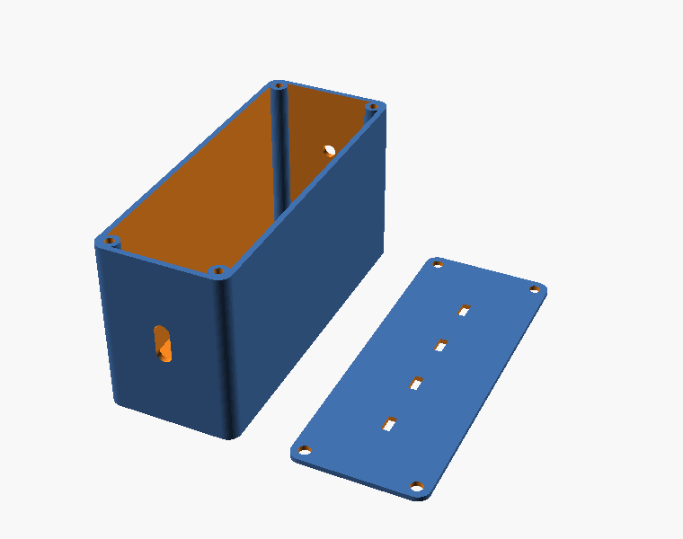
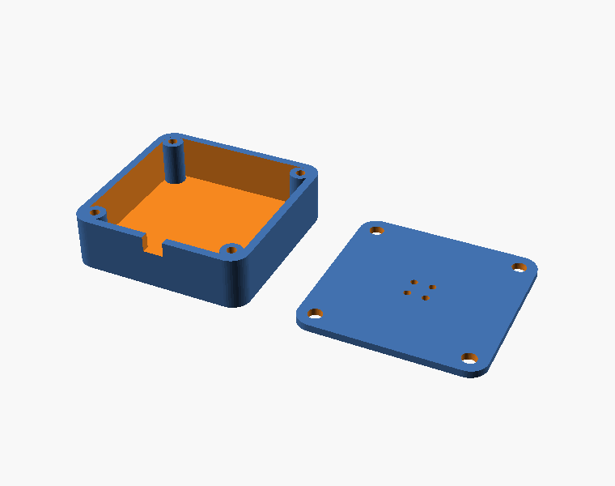
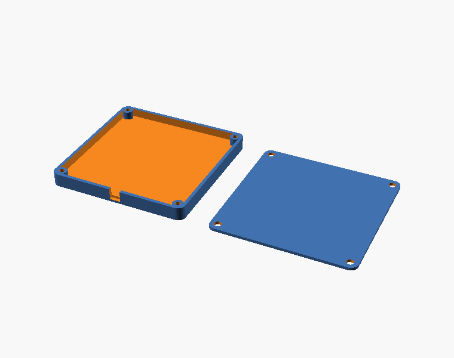
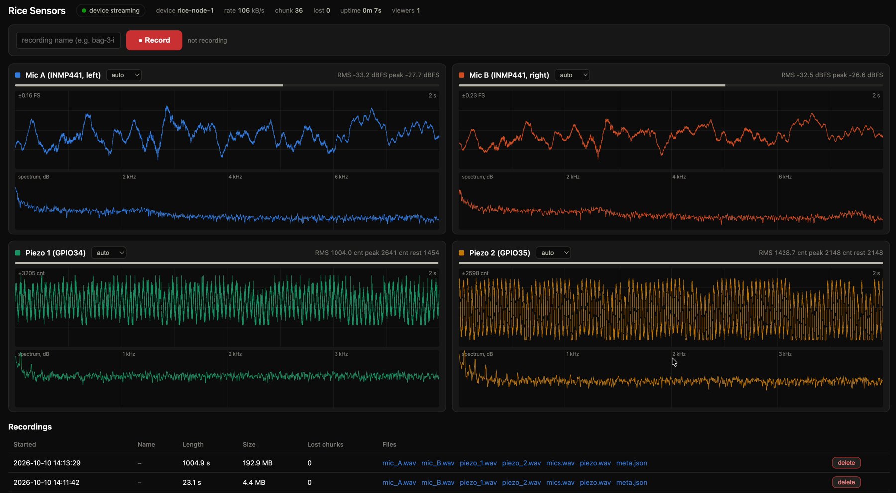
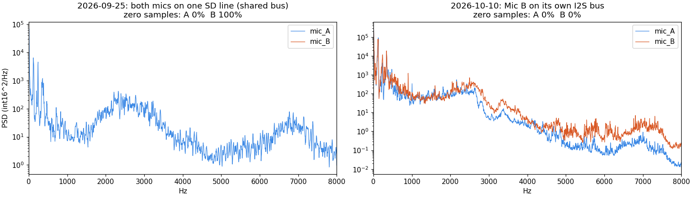
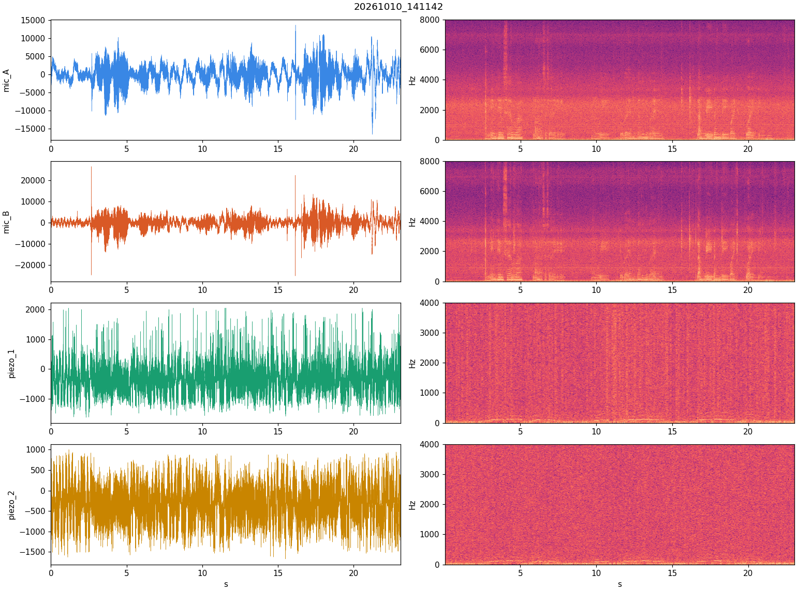

# grain-acoustics

**Acoustic and vibration sensing of stored-grain insects in bagged rice.**
An ESP32 sensor node with two MEMS microphones and two piezo contact sensors streams raw audio and
vibration to a self-hosted server that visualises, records and exports every channel for analysis.

<p align="center">
  
  
</p>

| | |
|---|---|
| Lab | Intelligent Systems & Mechatronics Research Laboratory (ISMR Labs) |
| Status | Prototype hardware built and streaming. Baseline recordings captured. No insect recordings yet. |
| Started | 25 September 2026 |
| Paper | [paper/grain-acoustics.pdf](paper/grain-acoustics.pdf) (4-page IEEE-style write-up, source in `paper/`) |
| Live dashboard | `https://sensors.dilanp.duckdns.org` (lab network only) |

---

## Contents

1. [What we are trying to do](#1-what-we-are-trying-to-do)
2. [How we are doing it](#2-how-we-are-doing-it)
3. [System architecture](#3-system-architecture)
4. [Hardware](#4-hardware)
5. [Firmware](#5-firmware)
6. [Server and dashboard](#6-server-and-dashboard)
7. [Data](#7-data)
8. [Results so far](#8-results-so-far)
9. [Known problems and next steps](#9-known-problems-and-next-steps)
10. [Companion builds: audio node and The Oracle](#10-companion-builds-audio-node-and-the-oracle)
11. [Repository layout](#11-repository-layout)
12. [Getting started](#12-getting-started)
13. [References](#13-references)
14. [Licence and citation](#14-licence-and-citation)

---

## 1. What we are trying to do

Rice is stored and sold in Sri Lanka in 5 kg retail bags that sit in warehouses for weeks.
Infestation by stored-product insects (rice weevil *Sitophilus oryzae*, lesser grain borer
*Rhyzopertha dominica*, red flour beetle *Tribolium castaneum*, saw-toothed grain beetle
*Oryzaephilus surinamensis*, rice moth *Corcyra cephalonica*) starts with a handful of
individuals that are invisible from outside the bag. By the time damage is visible the whole
stack is affected.

Insects inside grain are not silent. Feeding, chewing and walking produce short broadband
clicks, carried both as airborne sound and as substrate vibration through the packed kernels.
Acoustic detection of stored-grain insects has been demonstrated since the 1990s with
laboratory-grade sensors (see [References](#13-references)). What does not exist is a cheap,
networked sensor that a warehouse could attach to a bag.

**Research questions**

1. Can a low-cost MEMS microphone and a bare piezo disc, coupled to a sealed 5 kg rice bag,
   capture insect feeding or movement signals above the warehouse noise floor?
2. Which coupling (airborne mic, contact piezo on the bag wall, probe into the grain) gives the
   best signal-to-noise ratio for the smallest insects?
3. Can the recordings be used to train a detector that flags an infested bag early?

**What this repository holds**

- the complete sensor node design (wiring, firmware, 3D-printed enclosures),
- the server that ingests, visualises and records the streams,
- every recording made so far, with per-channel WAV exports and metadata,
- the analysis scripts and figures,
- an experiment log and the literature that motivates the design.

## 2. How we are doing it

The work is staged. Stage 1 and 2 are done; the rest is planned.

| Stage | Goal | Status |
|---|---|---|
| 1. Sensor node | Stream two mics and two piezos at full rate over Wi-Fi | Done (10 Oct 2026) |
| 2. Recording platform | Live view, one-button recording, per-channel download | Done |
| 3. Baseline characterisation | Noise floor of each channel on an empty bag and a clean bag | In progress |
| 4. Coupling experiments | Compare mic-on-bag, piezo-on-bag, piezo-on-plate, probe-in-grain | Next |
| 5. Insect recordings | Seeded bags with known counts of adults and larvae, control bags | Planned |
| 6. Detection | Event detector and classifier on the labelled recordings | Planned |
| 7. Warehouse pilot | Several nodes on a stack, long-duration recording | Planned |

### Measurement approach

- **Two channels of each kind** so that a signal present on one sensor and absent on the other
  can be separated from electrical noise common to both, and so that a sensor on the bag can be
  compared with an identical reference sensor on the shelf.
- **Raw streaming, no on-device processing.** The node sends every sample. All filtering and
  detection happens on the server, so algorithms can be changed without reflashing and every
  recording is reusable.
- **Highest sample rate the link allows.** Mics at 16 kHz and piezos at 8 kHz, which covers the
  1 to 6 kHz band where most reported stored-grain insect energy lies, at about 100 kB/s.
- **Recordings are first-class data.** Every session is written as WAV plus a JSON sidecar with
  rates, formats and gap accounting, and each channel is exported as its own mono file.

## 3. System architecture



The node and server exchange a small binary format (`SNS1`) described in
[docs/protocol.md](docs/protocol.md). The server reply to each chunk can carry commands back to
the node, which keeps a single outgoing HTTP connection and works through the reverse proxy.

## 4. Hardware

### 4.1 Bill of materials

| Qty | Part | Role | Notes |
|---|---|---|---|
| 1 | ESP32-WROOM-32U dev board | Controller | U variant has a u.FL antenna connector; an external antenna was required (built-in trace antenna gave −83 dBm) |
| 2 | INMP441 I2S MEMS microphone module | Airborne sound | 24-bit, omnidirectional, 61 dB SNR |
| 2 | Piezo disc, 27 mm brass | Contact vibration | Bare, no amplifier (deliberate first pass) |
| 4 | 100 kΩ resistor | Piezo series protection | |
| 2 | 1 MΩ resistor | Piezo load / bleed | 10 MΩ was tried first; 1 MΩ reduces hum pickup |
| 2 | BAT54S dual Schottky | Piezo clamp to 0 V and 3.3 V | |
| 2 | 100 kΩ + 22 kΩ divider | 0.55 V piezo bias | Sits mid-range of the 0 dB ADC window (0 to 1.1 V) |
| 1 | LED + 330 Ω | Status | GPIO 4 |
| 4 | Braided 4-core cable, 1 m | Sensor leads | Nylon braid, 4 mm |
| 1 set | 3D-printed enclosures | Controller box, 2 mic pods, 2 piezo pads | PLA+, see [hardware/enclosures](hardware/enclosures) |
| 1 | 2.4 GHz external antenna, u.FL | Wi-Fi | |

Full list with alternatives in [hardware/bom.md](hardware/bom.md).

### 4.2 Wiring

Mic B originally shared the I2S data line with Mic A (one mic per left/right slot). That
configuration never produced a usable Mic B signal and corrupted Mic A whenever both were
connected. Since 10 Oct 2026 each mic has its own I2S peripheral.

| ESP32 pin | Connects to | Bus |
|---|---|---|
| 3V3 | Mic A VDD, Mic B VDD, piezo bias divider top, clamp diodes | |
| GND | Mic A GND, Mic B GND, Mic A L/R, Mic B L/R, bias divider bottom, clamp diodes, LED cathode | |
| GPIO 26 | Mic A SCK | I2S1 |
| GPIO 25 | Mic A WS | I2S1 |
| GPIO 33 | Mic A SD | I2S1 |
| GPIO 14 | Mic B SCK | I2S0 |
| GPIO 27 | Mic B WS | I2S0 |
| GPIO 32 | Mic B SD | I2S0 |
| GPIO 34 | Piezo 1 through 100 kΩ, 0.55 V bias, 1 MΩ load, BAT54S clamps | ADC1 ch 6 |
| GPIO 35 | Piezo 2, same network | ADC1 ch 7 |
| GPIO 4 | Status LED through 330 Ω | |



Piezo discs are glued inside the printed 57 mm pads; the pad is laid against or under the bag.
Mic modules sit in the 30 mm pods behind a 4-hole grille. The complete wiring with photos is in
[docs/wiring.md](docs/wiring.md).

### 4.3 Enclosures

Designed in OpenSCAD on the lab's Forge print service and printed in PLA+ on a Creality
Ender-3 V3 SE. Sources, STL files, preview renders and sliced G-code are in
[hardware/enclosures](hardware/enclosures).

| Part | Outer size (mm) | Notes |
|---|---|---|
| ESP32 controller box + lid | 75 × 82 × 42 (box + lid as printed) | USB-C cutout on one end, four 4 mm cable glands on one long wall, M3 corner posts |
| Mic pod + lid | 30 × 30 × 8.7 | 4-hole sound grille in the lid, rim notch for the cable, M2 posts |
| Piezo pad + lid | 57 × 57 × 5.5 | 3 mm cavity for a 27 mm disc with room for larger discs, M2.5 posts |

<p align="center">
  
  
  
</p>

## 5. Firmware

`firmware/rice_sensors/rice_sensors.ino`, Arduino-ESP32 core 3.3.x, board "ESP32 Dev Module".

- **Mics.** Two independent I2S standard-mode RX channels (ESP-IDF 5 `i2s_std` driver), 32-bit
  Philips stereo slots, left slot kept, shifted to int16 (bits 29..14 of the 24-bit sample).
  Each 100 ms chunk is read in two 50 ms halves per mic so both DMA rings stay small (4 × 256).
- **Piezos.** The classic ESP32 has only two I2S peripherals and the DMA ADC driver uses one of
  them, so once Mic B took I2S0 the piezos moved to a hardware timer at 8 kHz that wakes a
  high-priority task which reads both ADC channels (one-shot driver) into a ring buffer.
  Measured rate 7987 to 8013 Hz.
- **Transport.** A FreeRTOS queue of 6 chunk buffers feeds an HTTP task that POSTs each chunk
  with keep-alive. Chunks are dropped, not delayed, if Wi-Fi stalls, and the server zero-fills
  gaps so recordings stay time-aligned.
- **Wi-Fi.** Scan before connect, 19.5 dBm TX power, reconnect watchdog, OTA updates
  (hostname `rice-node-1`). Credentials live in a git-ignored `secrets.h`.
- **LED.** Slow blink = connecting, solid = streaming, fast blink = server errors.

Other sketches in `firmware/` belong to the companion builds (section 10) or are bench tests.
`firmware/archive/` keeps the shared-bus version for reference.

## 6. Server and dashboard

`server/` is a FastAPI application in Docker (`python:3.12-slim`, runs as an unprivileged user).

- `POST /api/ingest` parses `SNS1` chunks, tracks sequence gaps and device stats, and fans each
  chunk out to WebSocket clients through bounded per-client queues.
- The recorder writes `mics.wav` (2 ch, 16 kHz) and `piezo.wav` (2 ch, 8 kHz, raw ADC − 2048)
  plus `meta.json`, and on stop exports `mic_A.wav`, `mic_B.wav`, `piezo_1.wav`, `piezo_2.wav`.
- The dashboard shows four oscilloscopes with live spectra, RMS and peak levels, a record
  button, device statistics (rate, lost chunks, uptime) and the recordings table with one link
  per channel.
- Playback in the browser uses a jitter buffer of 0.4 s so the scopes stay smooth at 30 fps.

<p align="center">
  
</p>

API and deployment details: [docs/protocol.md](docs/protocol.md), [docs/deployment.md](docs/deployment.md).

## 7. Data

All recordings are in [`data/`](data). Layout and conventions are in [data/README.md](data/README.md).

| Session | Hardware state | Length | Where |
|---|---|---|---|
| `data/sessions-2026-09-25/` | Shared I2S bus, Mic B dead, piezos at 10 kHz | 3 × 30 to 50 s | in repo (mics only) |
| `data/sessions-2026-10-10-prelim/` | Bench tests during the bus change | 4 clips | in repo |
| `data/recordings/20261010_141142/` | Final wiring, handling and speech test | 23.1 s | in repo, all channels |
| `data/recordings/20261010_141329/` | Final wiring, 17 minute quiet-room baseline | 1004.9 s | GitHub release asset (93 MB) |
| `data/recordings/20261010_150038/` | Final wiring, short check | 8.2 s | in repo, all channels |

Formats: mics are int16 PCM at 16 kHz (INMP441 24-bit shifted right by 14). Piezos are int16
at 8 kHz holding raw 12-bit ADC counts minus 2048, so the resting level is about −330 and full
scale is ±2048 (0 dB attenuation, 0 to 1.1 V window, 0.55 V bias).

Media (photos, videos, dashboard screenshots) are in [`media/`](media); the full-resolution
videos are release assets. Photo EXIF data has been stripped.

## 8. Results so far

### 8.1 Mic B: shared bus vs separate bus

<p align="center"></p>

On the shared data line Mic B returned 100 % zero samples and Mic A was intermittently
corrupted (bit-pattern garbage with a 640 ms period). On its own bus, Mic B's level and spectrum
match Mic A within 1 dB. Both mics are healthy.

### 8.2 Channel overview, session 20261010_141142

<p align="center"></p>

| Channel | RMS | Peak | Energy below 100 Hz | 50 Hz hum above neighbours |
|---|---|---|---|---|
| mic_A | −22.5 dBFS | −5.9 dBFS | 51 % | 1.9 dB |
| mic_B | −23.1 dBFS | −1.9 dBFS | 48 % | 0.9 dB |
| piezo_1 | −12.9 dBFS | 0 dBFS | 80 % | −0.9 dB |
| piezo_2 | −12.8 dBFS | −1.8 dBFS | 78 % | −0.7 dB |

(Stats produced by `tools/analysis/spectrogram.py`; this session included deliberate handling
and speech, so levels are not a noise floor.)

### 8.3 Quiet check, session 20261010_150038

| Channel | RMS | Clipped | Energy below 100 Hz | 50 Hz hum above neighbours |
|---|---|---|---|---|
| mic_A | −26.4 dBFS | 0 % | 94 % | −4.9 dB |
| mic_B | −31.7 dBFS | 0 % | 93 % | −3.3 dB |
| piezo_1 | −5.0 dBFS | 6.9 % | 94 % | 30.7 dB |
| piezo_2 | −3.6 dBFS | 15.5 % | 96 % | 31.6 dB |

**Reading:** the microphones are quiet and dominated by low-frequency room rumble, as expected
for an unmounted mic on a table. The bare piezos are dominated by 50 Hz mains hum, 30 dB above
the surrounding spectrum, and clip on peaks. The piezo channel in its present form cannot see
small signals; this is the first problem to fix (section 9).

## 9. Known problems and next steps

**Piezo channel**

1. Mains hum. The disc and its 1 m lead act as an antenna into a high-impedance input.
   Planned: shielded cable with the shield to GND, shorter leads, and trying a 470 kΩ load.
2. Sensitivity. A bare disc into a 12-bit ADC resolves about 0.27 mV per count. Insect
   feeding signals at the bag wall are expected in the tens of microvolts. Planned: an LM324
   charge amplifier (gain about 1000, 300 Hz to 5 kHz band-pass) between disc and ADC. The
   firmware needs no change except the bias level.
3. Mounting. Thin hard bonding (cyanoacrylate or thin epoxy) of the brass face to a stiff thin
   plate, or to a metal probe pushed into the grain, instead of hot glue to plastic, which damps
   the 1 to 5 kHz band of interest.

**Microphones**

4. Add a server-side 100 Hz high-pass for display and an optional one for export so rumble does
   not mask events.
5. Mount the pods on the bag with the grille against the fabric and foam around them.

**Experiments**

6. Baseline: 1 hour quiet-warehouse recording with the sensors on an empty table, then on a
   clean sealed bag.
7. Seeded trials: bags with 10, 50 and 200 adult *S. oryzae*, matched controls, recorded for
   24 hours each, sensors in all four coupling positions.
8. Labelling tool and a simple energy-in-band event detector as the first classifier.

## 10. Companion builds: audio node and The Oracle

Two further ESP32 builds were made with the same toolchain and server pattern, and are kept
here because they share code and lessons. Neither is part of the measurement chain.

- **Audio node** (`firmware/audio_node/`, `audio-server/`): one INMP441 up-link plus a
  UDA1334A I2S DAC, mono amplifier and 30 W speaker for playback of a server-side sound
  library. Used to test the DAC chain and the command-in-reply pattern.
- **The Oracle** (`firmware/oracle_node/`, `oracle-server/`): an offline-first voice assistant
  on the same hardware. WiFiManager captive portal, push-to-talk, server pipeline of
  WebRTC VAD → faster-whisper → wake word "Oracle" → Claude with tools → Piper TTS → playback.
  Verified end to end with the simulator; the physical DAC chain on the test board is still
  silent (hardware fault under investigation). Needs an `ANTHROPIC_API_KEY` in its `.env`.

Details for both are in [docs/companion-builds.md](docs/companion-builds.md).

## 11. Repository layout

```
grain-acoustics/
├── README.md                this file
├── paper/                   LaTeX write-up (IEEEtran) + compiled PDF
├── docs/
│   ├── wiring.md            pin map, input networks, photos of the build
│   ├── protocol.md          SNS1 / AUD1 wire formats and REST + WebSocket API
│   ├── deployment.md        Docker stack, reverse proxy, OTA, flashing
│   ├── experiment-log.md    dated log of every session and change
│   ├── companion-builds.md  audio node and The Oracle
│   ├── references.md        annotated bibliography
│   └── figures/             generated plots and stats
├── firmware/
│   ├── rice_sensors/        the sensor node sketch (+ secrets.h.example)
│   ├── archive/             superseded shared-bus sketch
│   ├── audio_node/ oracle_node/   companion builds
│   └── dac_check/ noise_test/ play_music/ play_floor/ tone_test/   bench tests
├── server/                  sensors platform (FastAPI + dashboard)
├── audio-server/ oracle-server/   companion servers
├── hardware/
│   ├── bom.md
│   └── enclosures/          OpenSCAD, STL, renders, G-code
├── data/
│   ├── recordings/          per-session folders with WAVs + meta.json
│   ├── sessions-2026-09-25/ early shared-bus recordings
│   └── sessions-2026-10-10-prelim/
├── media/
│   ├── photos/              build photos (EXIF stripped)
│   ├── screenshots/         dashboard
│   └── video/               posters; full videos on the release page
└── tools/
    ├── simulate_node.py     fake node for server testing
    ├── simulate_audio_node.py  simulate_oracle.py
    └── analysis/spectrogram.py
```

## 12. Getting started

**Server**

```bash
cd server
docker compose up -d --build        # listens on :8001
python3 ../tools/simulate_node.py localhost:8001 30   # fake node for 30 s
open http://localhost:8001
```

**Node**

```bash
cp firmware/rice_sensors/secrets.h.example firmware/rice_sensors/secrets.h   # edit SSID, password, OTA password
# set SERVER_URL in rice_sensors.ino to your server
arduino-cli compile --fqbn esp32:esp32:esp32 firmware/rice_sensors
arduino-cli upload  --fqbn esp32:esp32:esp32 -p /dev/cu.usbserial-XXXX firmware/rice_sensors
# later, over the air:
arduino-cli upload --fqbn esp32:esp32:esp32 -p <node-ip> --upload-field password=<OTA_PASS> firmware/rice_sensors
```

Opening the serial port with DTR/RTS asserted resets the board. Use
`pyserial` with `dtr=False, rts=False` set before `open()` if you need to watch the log without a reboot.

**Analysis**

```bash
python3 -m pip install numpy scipy matplotlib
python3 tools/analysis/spectrogram.py data/recordings/20261010_141142 docs/figures
```

## 13. References

Annotated versions with notes on relevance are in [docs/references.md](docs/references.md).

**Insect acoustics in stored grain**

1. Mankin, R. W., Hagstrum, D. W., Smith, M. T., Roda, A. L., Kairo, M. T. K. (2011).
   Perspective and promise: a century of insect acoustic detection and monitoring.
   *American Entomologist* 57(1): 30–44. https://doi.org/10.1093/ae/57.1.30
2. Mankin, R. W., Hagstrum, D., Guo, M., Eliopoulos, P., Njoroge, A. (2021). Automated
   applications of acoustics for stored product insect detection, monitoring, and management.
   *Insects* 12(3): 259. https://doi.org/10.3390/insects12030259
3. Hagstrum, D. W., Flinn, P. W. (1993). Comparison of acoustical detection of several species
   of stored-grain beetles over a range of temperatures. *Journal of Economic Entomology*
   86(4): 1271–1278. https://doi.org/10.1093/jee/86.4.1271
4. Shuman, D., Coffelt, J. A., Vick, K. W., Mankin, R. W. (1993). Quantitative acoustical
   detection of larvae feeding inside kernels of grain. *Journal of Economic Entomology*
   86(3): 933–938. https://doi.org/10.1093/jee/86.3.933
5. Potamitis, I., Ganchev, T., Kontodimas, D. (2009). On automatic bioacoustic detection of
   pests: the cases of *Rhynchophorus ferrugineus* and *Sitophilus oryzae*. *Journal of Economic
   Entomology* 102(4): 1681–1690. https://doi.org/10.1603/029.102.0436
6. Eliopoulos, P. A., Potamitis, I., Kontodimas, D. C., Givropoulou, E. G. (2015). Detection of
   adult beetles inside the stored wheat mass based on their acoustic emissions. *Journal of
   Economic Entomology* 108(6): 2808–2814. https://doi.org/10.1093/jee/tov231
7. Fleurat-Lessard, F., Tomasini, B., Kostine, L., Fuzeau, B. (2006). Acoustic detection and
   automatic identification of insect stages activity in grain bulks by noise spectra processing
   through classification algorithms. *Proceedings of the 9th International Working Conference on
   Stored Product Protection*, Campinas, Brazil, 476–486.

**Biotremology and DIY piezo contact microphones**

8. Gjonov, I., Lapeva-Gjonova, A., Pramatarova, M. (2025). Biotremological research using a
   DIY piezoelectric contact microphone: examples with insects. *Biodiversity Data Journal* 13:
   e143481. https://doi.org/10.3897/BDJ.13.e143481. Direct model for the piezo pad and its
   3D-printed box.
9. Hill, P. S. M., Wessel, A. (2016). Biotremology. *Current Biology* 26(5): R187–R191.
   https://doi.org/10.1016/j.cub.2016.01.054

**Components and software**

10. TDK InvenSense. *INMP441 omnidirectional microphone with bottom port and I2S digital output*,
    datasheet. https://invensense.tdk.com/products/digital/inmp441/
11. Espressif Systems. *ESP32 Technical Reference Manual*, chapters on I2S and SAR ADC.
    https://www.espressif.com/en/support/documents/technical-documents
12. Espressif Systems. ESP-IDF programming guide: I2S standard mode driver and ADC oneshot
    driver. https://docs.espressif.com/projects/esp-idf/en/stable/esp32/api-reference/peripherals/
13. Arduino-ESP32 core. https://github.com/espressif/arduino-esp32
14. FastAPI. https://fastapi.tiangolo.com/
15. NXP. *UDA1334ATS low power audio DAC with PLL*, datasheet (companion builds).
16. faster-whisper, Piper TTS, WebRTC VAD and the Anthropic Python SDK (The Oracle).

## 14. Licence and citation

Code is released under the MIT licence (see [LICENSE](LICENSE)). Recordings, photos, figures
and documentation are released under Creative Commons Attribution 4.0 (CC BY 4.0). If you use
the data or design, please cite this repository (see [CITATION.cff](CITATION.cff)).

Maintainer: Dilan Perera, ISMR Labs.
