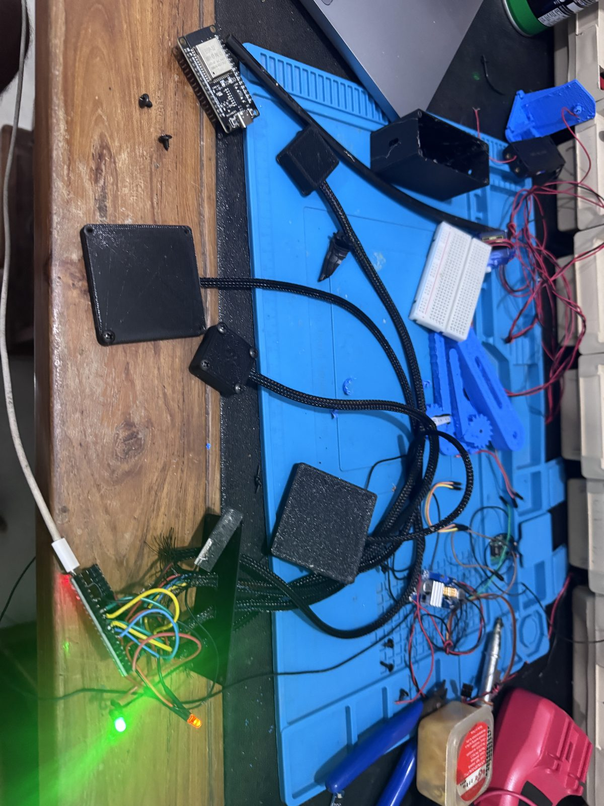
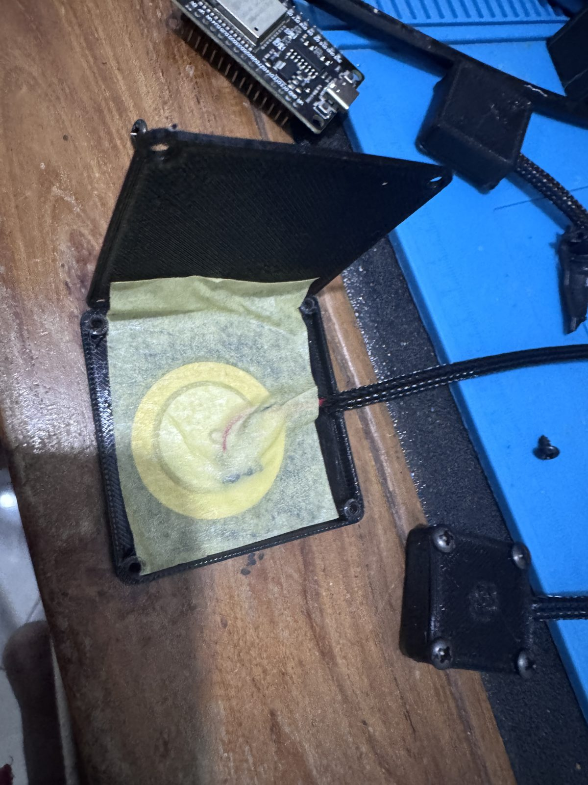
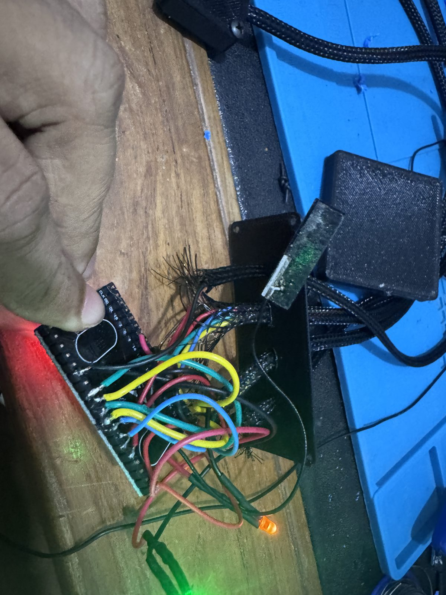
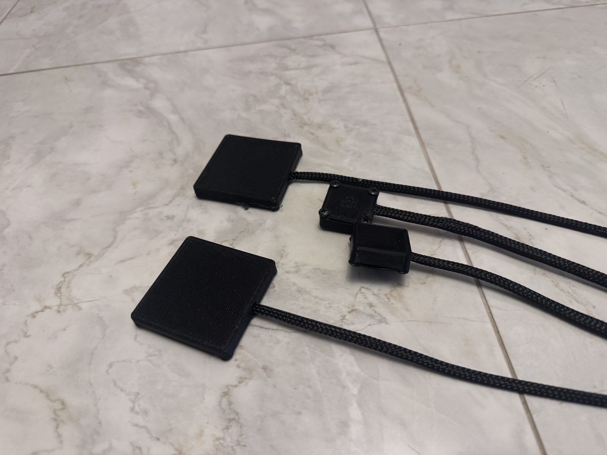
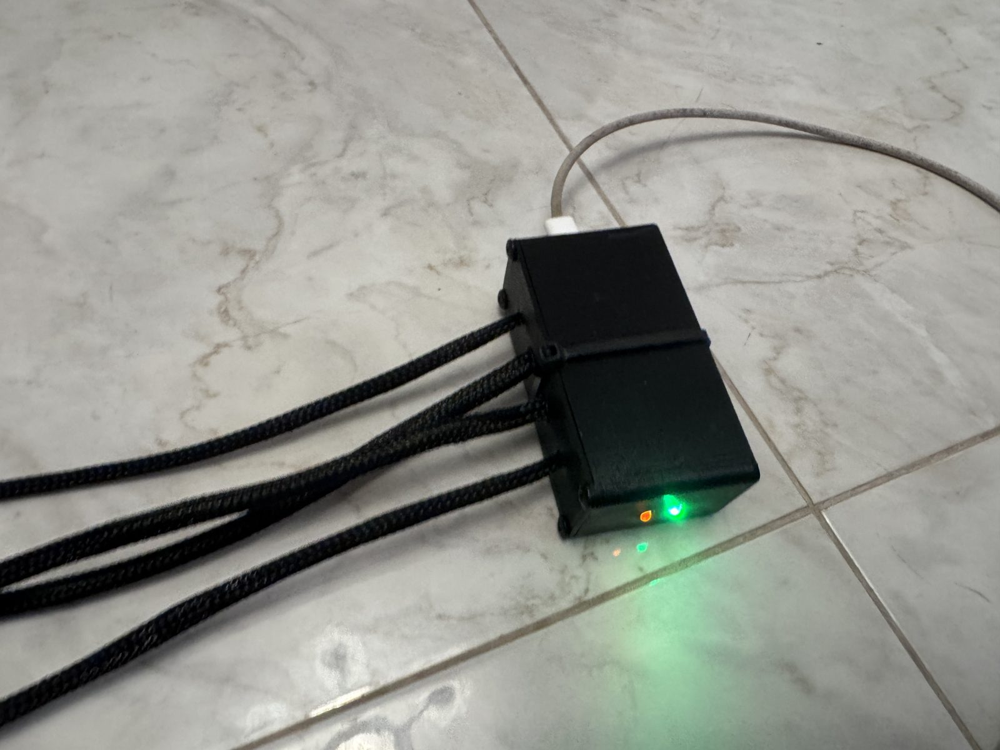
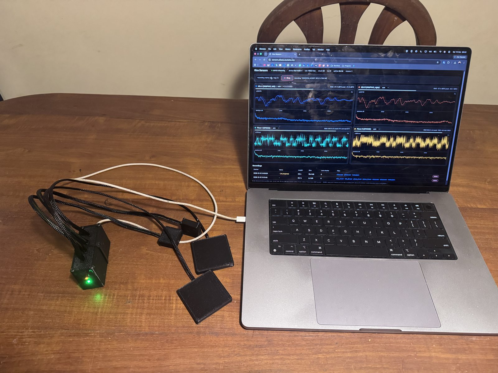

# Wiring

Board: ESP32-WROOM-32U development board ("ESP32 Dev Module" in Arduino). The U variant has no
PCB antenna; fit a 2.4 GHz antenna to the u.FL socket or the link will not hold at 100 kB/s.

## Pin map (since 10 Oct 2026)

| ESP32 pin | Function | Connects to |
|---|---|---|
| 3V3 | power | Mic A VDD, Mic B VDD, bias divider top, clamp diode cathodes |
| GND | ground | Mic A GND, Mic B GND, Mic A L/R, Mic B L/R, divider bottom, clamp anodes, LED cathode |
| GPIO 26 | I2S1 BCLK | Mic A SCK |
| GPIO 25 | I2S1 WS | Mic A WS |
| GPIO 33 | I2S1 DIN | Mic A SD |
| GPIO 14 | I2S0 BCLK | Mic B SCK |
| GPIO 27 | I2S0 WS | Mic B WS |
| GPIO 32 | I2S0 DIN | Mic B SD |
| GPIO 34 | ADC1 ch 6 (input only) | Piezo 1 network |
| GPIO 35 | ADC1 ch 7 (input only) | Piezo 2 network |
| GPIO 4 | output | status LED through 330 Ω to GND |

Both mics have L/R tied to GND, so each returns its data in the left slot of its own bus.

### Why two buses

The INMP441 shares one data line between two modules by assigning one to each stereo slot.
In practice Mic B never produced data on the shared line (its SD never left tri-state), and a
dead or unpowered chip on the shared SD line corrupted Mic A as well (74 % zero samples,
640 ms periodic bit garbage). Giving Mic B the second I2S peripheral fixed both symptoms in one
step. The cost is that the DMA ADC driver, which also needs I2S0 on the classic ESP32, had to be
replaced by timer-paced one-shot ADC reads for the piezos.

## Piezo input network (one per disc)

```
            100 kΩ
piezo + ────/\/\/\────┬──────────── GPIO 34 (or 35)
                      │
                     1 MΩ
                      │
   3V3 ──100 kΩ──┬────┴── 0.55 V bias node
                 22 kΩ
                 │
piezo − ────────GND

   BAT54S between GPIO pin and GND / 3V3 (clamps spikes from knocks)
```

- 0 dB ADC attenuation gives a 0 to 1.1 V window; 0.55 V bias puts rest at mid-scale.
  Measured rest is about 1700 counts (0.46 V), lower than the nominal 2048.
- 10 MΩ was the first load value. It gave more low-frequency sensitivity but far more hum, and
  the bias drifted. 1 MΩ is the current compromise; 470 kΩ is the next thing to try.
- Full scale is reached by a firm tap on the pad. 50 Hz hum is 30 dB above the spectrum
  around it on a quiet bench, which is the dominant problem (see README section 9).
- The disc is 27 mm brass. The brass face is bonded inside the printed pad.

## Microphone pods

INMP441 breakout boards in 30 mm pods with a 4-hole grille in the lid. VDD is 3.3 V from the
board; the module has its own decoupling. The 24-bit sample arrives in a 32-bit slot; the
firmware keeps bits 29..14 as int16.

The mic needs about 100 ms after power-up before data is valid; the firmware discards that.

## Cabling

Four 1 m braided 4-core leads leave the controller box through 4 mm glands on one long wall.
Mic leads carry 3V3, GND, SCK, WS, SD (five conductors, so two cores are shared between
power and the L/R tie). Piezo leads carry signal and ground only; the input network sits on the
board inside the controller box.

For the next revision the piezo leads should be shielded with the shield to GND at the box end.

## Photos

| | |
|---|---|
|  Bench: ESP32 breakout, leads and pads |  Piezo disc in its printed pad |
|  Input networks on the ESP32 header |  Two piezo pads, two mic pods |
|  Controller box, four glands, status LED |  Streaming to the dashboard |
