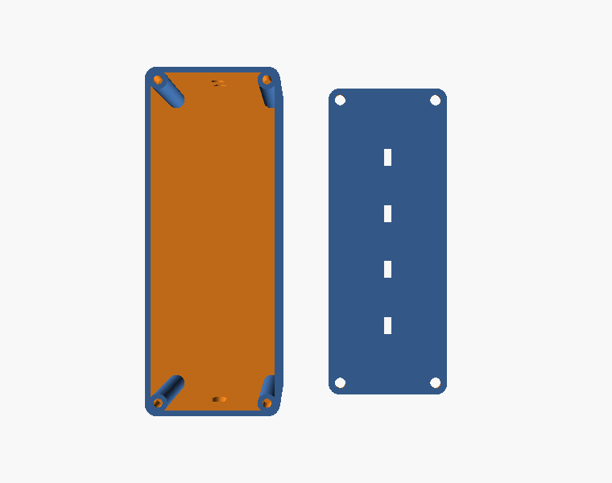
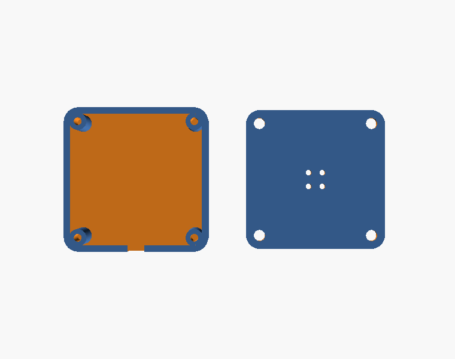
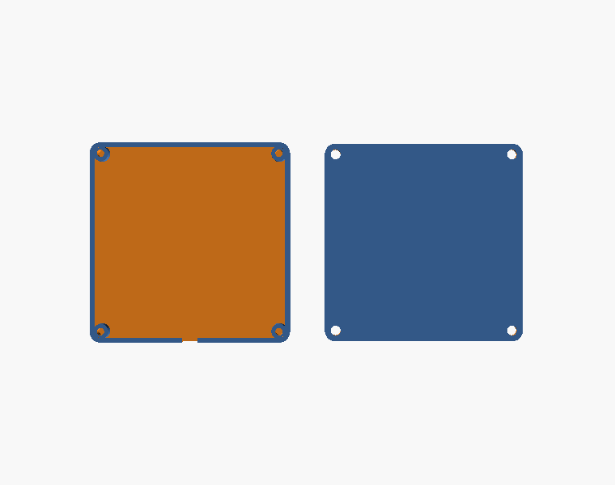

# Enclosures

All parts are OpenSCAD, designed on the lab's Forge service (OpenSCAD → STL → G-code for a
Creality Ender-3 V3 SE, 220 × 220 × 250 mm bed). Each `.scad` builds box and lid in one file;
set `part = "all" | "box" | "lid"` at the top.

| Folder | Part | Outer (mm) | Inner clear (mm) | Posts | Notes |
|---|---|---|---|---|---|
| `esp32-controller-box/` | Controller box + lid | 75.2 × 81.6 × 41.7 as laid out; box inner 20 × 70 × 40 | 20 × 70 × 40 | M3 | USB-C cutout on a short end, 4 × Ø4 mm cable holes on a long wall, 1.35 mm walls (3 × 0.45 lines) |
| `mic-box/` | Mic pod + lid | 30 × 30 × 8.7 | 27.3 × 27.3 × 7 | M2 | 4-hole sound grille in the lid, rim notch for the cable; a round module ≤ 25 mm clears the posts |
| `piezo-box/` | Piezo pad + lid | 57 × 57 × 5.5 | 54.3 × 54.3 × 3 | M2.5 | takes discs up to ~54 mm; rim notch for the lead |

Each folder has the `.scad` source, the rendered `.stl`, and `-iso/-top/-front.png` previews.
`gcode/` holds the sliced files actually printed (PLA+, 210 °C nozzle / 60 °C bed, 0.20 mm,
3 walls).

Printing notes

- Walls were set to exactly 3 × 0.45 mm so the slicer fills them with perimeters only and does
  not add gap-fill squiggles around the cable holes.
- Pads print lid-down for a flat contact face. Pods print box-down.
- The piezo pad floor (2 mm) is the contact surface; bond the brass side of the disc to it with a
  thin hard adhesive, not hot glue, for best high-frequency coupling.

Renders

| Controller box | Mic pod | Piezo pad |
|---|---|---|
|  |  |  |
|  |  |  |
